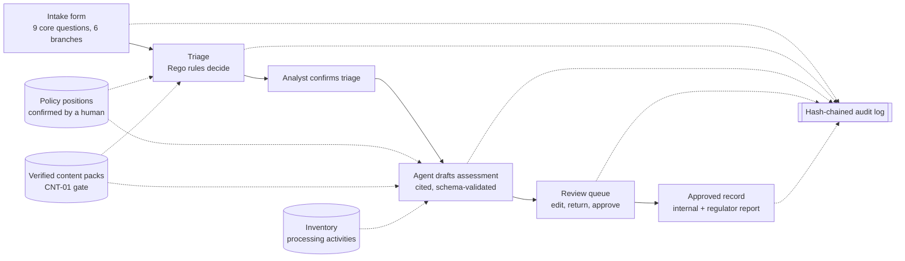
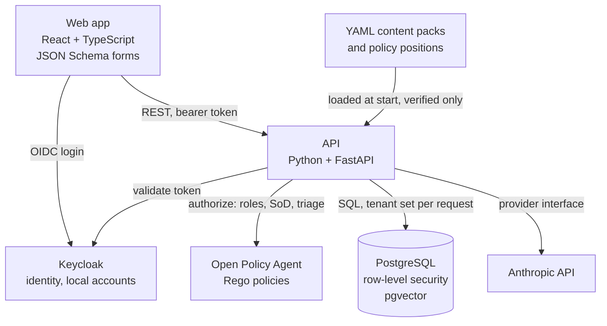

# Architecture

The rules engine decides, the agent drafts and explains, and only the review queue, driven by people, turns a draft into an approved record. Every step writes to a tamper-evident audit log.

## Platform flow

## Services

| Service | v1 choice | Why |
| --- | --- | --- |
| Backend | Python with FastAPI | Typed request and response models fit agent structured outputs |
| Database | PostgreSQL with row-level security and pgvector | Tenant isolation enforced in the database engine itself, not only in application code |
| Front end | React in TypeScript with JSON Schema-driven forms | Intake branches are defined once as schema and rendered automatically |
| Identity | Keycloak | Local accounts now; SSO, SAML, OIDC and SCIM later with no rework |
| Policy as code | Rego (Open Policy Agent) | Roles, segregation of duties and triage rules that an auditor can read directly |
| Content | YAML content packs and policy positions | Versioned, reviewable, diffable |
| Model access | Anthropic API behind a provider interface | Model-agnostic and swappable |
| Packaging | Docker Compose with seeded demo data | One command to run |

## Trust boundaries and key controls

| Boundary | Control | Requirement |
| --- | --- | --- |
| Tenant to tenant | Every table carries a tenant ID; PostgreSQL row-level security policies filter on the tenant set for the request | PLT-01 |
| User to action | Each API action asks Open Policy Agent; roles live on tenant memberships, not users | PLT-04, PLT-05 |
| Agent to records | The agent runs under a system identity that cannot hold a role. It writes only to draft records; approval, mapping and policy endpoints refuse it | ARC-01, SOD-6 |
| Model output to user | Every agent output is validated against a schema, and every citation must resolve to a stored clause or policy position, before a person sees it | ARC-02 |
| Uploaded documents to model | Uploaded text is passed as data, never as instructions, with prompt-injection defenses mapped to OWASP LLM01 | ARC-03 |
| Content to rules engine | The loader refuses any rule without a verification record: primary citation, date verified, verifier | CNT-01 |
| Anyone to audit log | Append-only; each event stores the hash of the previous event; no role can edit or delete events | PLT-41, SOD-5 |

## Segregation of duties

| Rule | Enforced by |
| --- | --- |
| SOD-1 No one approves what they submitted, drafted or substantively edited | Rego, checked against the audit history of the assessment |
| SOD-2 High risk needs two distinct approvers (standard preset) | Rego, on the approval endpoint |
| SOD-3 Whoever proposes a policy or mapping change cannot approve it | Rego |
| SOD-4 Admins cannot change their own roles | Rego |
| SOD-5 No role can edit or delete audit events | Database permissions plus the hash chain |
| SOD-6 The agent can never approve | No role is grantable to the agent identity |

## Audit trail

Each event records who acted (user and role, or the agent with the user who triggered it), what changed, the content and policy versions in use, and `prev_hash`, the SHA-256 of the previous event in that tenant's chain. A verification command walks the chain and reports the first broken link. It runs daily and before every export, and a break notifies the tenant admin, the DPO and every auditor.

## Data model

The inventory centers on the processing activity, linked to systems, AI components, data categories, data subject groups, vendors and transfers. How the AI takes part in a decision is recorded on the processing activity, not the system, because the legal tests turn on use, not technology. See INV-01 to INV-09 in [requirements.md](requirements.md).
